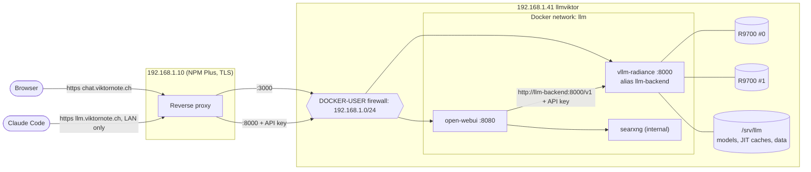

# Local LLM server

Ansible for a local inference host: **vllm-radiance** on two Radeon AI PRO R9700 cards,
**Open WebUI** for chat, and an Anthropic-compatible endpoint for **Claude Code**.
Nothing is configured by hand on the host.

> vllm-radiance is an experimental community project. The exact upstream versions and
> documents this setup is based on are recorded in [VERSIONS.md](VERSIONS.md).
> **This code has been linted and syntax-checked but not yet run against the host.**

| | |
|---|---|
| Host | `llmviktor`, 192.168.1.41, Ubuntu 26.04, kernel 7.0, EPYC 7642, 128 GB RAM |
| GPUs | 2x Radeon AI PRO R9700 (gfx1201), 32 GB each, tensor parallel 2 |
| Model | `amd/Qwen3.8-27B-Quark-AWQ-MXFP4`, FP8 KV cache, served as `qwen3.8-27b` (alias `claude-local`) |
| Default profile | `chat`: 131,072 tokens of context, up to 4 sequences (upstream-qualified) |
| Reverse proxy | NPM Plus on 192.168.1.10 (separate host, not managed here) |

## Architecture



Ports and proxy settings: [docs/reverse-proxy.md](docs/reverse-proxy.md).

## Layout

```
llm-server/
  ansible/
    inventory/group_vars/llm/   main.yml (all tunables), images.yml (digests), vault.yml.example
    playbooks/                  site.yml, smoke-test.yml, fallback-llamacpp.yml, sudo-nopasswd.yml
    roles/                      host_prep, docker, llm_firewall, llm_models, vllm_radiance,
                                open_webui, litellm*, radiance_engine*, llamacpp_fallback*, llm_monitoring
  scripts/                      smoke_test.py, bench.py, claude-code-env.{ps1,sh}, resolve-digest.sh
  docs/                         bios-kernel-checklist, reverse-proxy, kernel-update, troubleshooting
```

`*` optional, off by default.

## First run

Run Ansible from WSL (Ubuntu), in `llm-server/ansible`. The SSH key that is installed on the
host must be usable from WSL: copy it into `~/.ssh` there, or install the WSL key with
`ssh-copy-id viktor@192.168.1.41`.

```bash
cd llm-server/ansible
# Required when the repo sits on a Windows drive (/mnt/c/...): Ansible ignores
# ansible.cfg in world-writable directories, and without it no inventory is found.
# Cloning into the Linux home directory avoids this.
export ANSIBLE_CONFIG=$PWD/ansible.cfg
ansible-galaxy collection install -r requirements.yml

# Secrets
cp inventory/group_vars/llm/vault.yml.example inventory/group_vars/llm/vault.yml
$EDITOR inventory/group_vars/llm/vault.yml          # openssl rand -hex 32 for each secret
ansible-vault encrypt inventory/group_vars/llm/vault.yml

# Dry run, then deploy
ansible-playbook playbooks/site.yml --ask-become-pass --ask-vault-pass --check --diff
ansible-playbook playbooks/site.yml --ask-become-pass --ask-vault-pass

# Verify
ansible-playbook playbooks/smoke-test.yml --ask-become-pass --ask-vault-pass
```

`site.yml` refuses to run while `vault.yml` is plaintext. On the very first `--check` run,
tasks that depend on Docker being installed report errors or are skipped; that is expected.

The first deployment downloads about 20 GB of weights and a 4 GB image, then compiles
kernels and captures graphs. Ansible waits up to 45 minutes for `/health`. Later starts are
much faster because every JIT cache is kept in `/srv/llm/vllm-cache`.

To stop typing the sudo password, there is an opt-in playbook:
`ansible-playbook playbooks/sudo-nopasswd.yml --ask-become-pass` (read its header first).

## Context budget and profiles

Numbers are upstream's measurements on the same hardware, not mine
([docs/COMPOSE_CAPACITY.md](https://github.com/magiccodingman/vllm-radiance/blob/main/docs/COMPOSE_CAPACITY.md)).

- Usable VRAM: 2 x 32 GiB x 0.90 = 57.6 GiB. Weights: 18.44 GiB (9.2 GiB per card).
- With prefix caching and `align`, vLLM reported **576,001 usable KV tokens** at boot.
  That pool is shared: `max-num-seqs` is an admission ceiling, and KV blocks are allocated
  as sequences actually grow.
- Upstream completed 128K x 4 with prefix caching on, and 256K x 2 with prefix caching off.

| `llm_profile` | Context | Sequences | Status |
|---|---|---|---|
| `chat` (default) | 131,072 | 4 | Upstream's qualified production profile |
| `long` | 262,144 | 4 | **Untested.** Not qualified upstream with prefix caching on; the pool holds 2.2 full-length sequences |
| `coding` | 262,144 | 2 | **Untested.** Same pool as `long`, fewer admitted sequences |

Why four sequences: Open WebUI's title, tag and follow-up generation and Claude Code's
small-model and subagent calls each occupy a sequence for a few seconds. With fewer, they
queue behind your chat. `max_num_seqs: 1` is rejected by the role.

What happens when the pool fills (several very long conversations at once): vLLM
**preempts** the most recently admitted request, frees its KV blocks, and re-runs it when
space returns. Nothing fails, but that request stalls and its prefill is repeated. The
counter `vllm:num_preemptions_total` on `/metrics` shows it, and the smoke test prints it.
Requests beyond `max-num-seqs` wait in the queue. A prompt longer than `max-model-len` is
rejected with HTTP 400.

`long` and `coding` are there for when 131,072 tokens is not enough. If one of them fails to
start (out of memory during graph capture at 262,144), go back to `llm_profile: chat` in
`group_vars/llm/main.yml`.

### Switching profile

```bash
# one-off
ansible-playbook playbooks/site.yml --ask-become-pass --ask-vault-pass --tags engine -e llm_profile=long
# permanent: edit llm_profile in inventory/group_vars/llm/main.yml, then the same command without -e
```

The container is recreated and the model reloads (a few minutes with warm caches). Only one
model is ever loaded.

## Prefix caching

Enabled (`--enable-prefix-caching --mamba-cache-mode=align`). Qwen3.8 is a hybrid with
linear-attention (GDN) layers, and vLLM silently disables prefix caching for hybrids unless
both flags are given. Upstream measured a 12.8x lower time to first token on a 32K shared
prefix with byte-identical output. This is what makes long chats and Claude Code's large
repeated system prompt responsive. The smoke test sends the same ~20K-token prefix twice and
reports cold and warm time to first token plus the cache-hit counter.

## Claude Code

The pinned image is based on vLLM 0.30, which serves the Anthropic Messages API at
`/v1/messages` natively. The fork's own docs do not mention it, so the smoke test performs a
real tool round trip through it (tool call, tool result, final answer).

```powershell
. .\llm-server\scripts\claude-code-env.ps1     # Windows
claude
```
```bash
. llm-server/scripts/claude-code-env.sh        # Linux, macOS, WSL
claude
```

The scripts map every model slot (`ANTHROPIC_MODEL`, `ANTHROPIC_SMALL_FAST_MODEL`,
`ANTHROPIC_DEFAULT_OPUS/SONNET/HAIKU_MODEL`, `CLAUDE_CODE_SUBAGENT_MODEL`) to the local
model, set `CLAUDE_CODE_DISABLE_NONESSENTIAL_TRAFFIC=1`, and prompt for the API key instead
of storing it.

If the `/v1/messages` check fails, set `litellm_enabled: true`, re-run `site.yml`, forward
`llm.viktornote.ch` to port 4000 instead of 8000, and use `vault_litellm_master_key` as the key.

## Open WebUI

- Talks to the engine at `http://llm-backend:8000/v1` on the internal Docker network with
  the API key, never through the LAN port.
- Signup is disabled. The admin from the vault is created on the first run.
- Default model and task model are both `qwen3.8-27b`.
- Context length: Open WebUI does not truncate conversations for OpenAI-compatible backends
  (its `num_ctx` setting only applies to Ollama), so the full server context is available.
- `ENABLE_PERSISTENT_CONFIG=false`: the settings in `open-webui.env.j2` are applied on every
  start, and changes to those same settings in the admin UI do not survive a restart. Chats,
  users and uploaded documents are stored normally under `/srv/llm/open-webui`.
- The model's default reasoning effort is `medium` (upstream's default is `xhigh`; the
  template accepts only `low`, `medium` and `xhigh`). Change `vllm_default_reasoning_effort`
  and re-run with `--tags engine` to trade answer depth for speed.
- Toggles in `main.yml`: SearXNG web search (on), Postgres (off), trusted-header SSO for
  Authentik (off), CPU embedding model for RAG.

## Updating

**Image.** Follow the comment at the top of `inventory/group_vars/llm/images.yml`. For
vllm-radiance, also read the `VERSION` file of the matching upstream commit and update
`vllm_radiance_expected_version`; the smoke test compares it with the image. Then run
`site.yml` and `smoke-test.yml`. To roll back, restore the previous digest and re-run.

**Model.** Add or change an entry in `llm_models` (repo, revision, dirname, weight format,
GPU memory share, default profile), then run `site.yml --tags models,engine`. Every entry is
downloaded to `/srv/llm/models` and stays there until you delete it.

### Switching between models

Only one model is loaded at a time (the MXFP4 and FP8 27B together would leave almost no
KV cache). Two entries are configured:

| `llm_model` | Weights | Default profile | Status |
|---|---|---|---|
| `mxfp4` (default) | 18.4 GiB | `chat`: 131,072 x 4 | upstream-qualified, tested here |
| `fp8` | 28.75 GiB | `chat-fp8`: 131,072 x 2 | **untested here**; higher precision, smaller KV pool |

```bash
ansible-playbook playbooks/site.yml --ask-become-pass --ask-vault-pass --tags models,engine -e llm_model=fp8
```

The engine restarts and Open WebUI and Claude Code are unavailable while the model loads
(minutes with warm caches; the first start of a weight format compiles kernels again). To
make it permanent, change `llm_model` in `inventory/group_vars/llm/main.yml`.

Clients keep working without changes: the served name `qwen3.8-27b` and the alias
`claude-local` stay the same. A third name, `qwen3.8-27b-mxfp4` or `qwen3.8-27b-fp8`,
appears in Open WebUI's model list and shows which one is loaded. Switching is a redeploy,
not a dropdown choice in the UI or in Claude Code.

**Kernel and firmware.** Held on purpose. Procedure: [docs/kernel-update.md](docs/kernel-update.md).

## Experimental upstream features

All off (`vllm_experimental` in `main.yml`). Upstream's own status: speculative decoding
(DFlash2, MTP) has not passed its strict output-equivalence gate, MTP failed the tool-call
gate, and `normquant_fusion` / `fp8_stream` are marked "do not enable in production". DFlash2
is the one with a large measured gain (about 3x decode) and passed the sampled tool checks;
if you try it, it needs a drafter checkpoint, the V2 runner and `PIECEWISE` graphs, and
upstream ran it at 8K context only.

## Standalone radiance engine (optional)

The original author stopped maintaining vllm-radiance and recommends the standalone
[radiance](https://codeberg.org/StillDeadcode/radiance) engine. Its README claims OpenAI,
Anthropic Messages and llama-server APIs and lists Qwen3.8-27B MXFP4 on two R9700s. It is
not the default here because tool calling and streaming are undocumented for the Qwen
models, and it needs weights converted to its own `.rad` format (manual `rad-convert` step).
The `radiance_engine` role is an untested skeleton: set `llm_engine: radiance_engine` and
`radiance_engine_model_file`, then judge it with `smoke-test.yml`.

## Benchmark

```bash
export LLM_API_KEY=...        # from an allowed source, or on the host itself
python3 scripts/bench.py --base-url http://192.168.1.41:8000 --model qwen3.8-27b
```

Upstream's reference for this model without speculation: about 53 tok/s single stream and
102 tok/s aggregate at two streams.

## Dashboard (optional)

Prometheus + Grafana on the host, with a provisioned "Local LLM" dashboard: running and
waiting requests, generation and prompt tokens/s, KV-cache use, prefix-cache hit rate,
preemptions, time to first token, latency percentiles, and per-GPU load, VRAM, power,
temperature and fan speed. Prometheus keeps 30 days (`llm_prometheus_retention`).

```bash
ansible-vault edit inventory/group_vars/llm/vault.yml     # add vault_grafana_admin_password
# set llm_dashboard_enabled: true in inventory/group_vars/llm/main.yml
ansible-playbook playbooks/site.yml --ask-become-pass --ask-vault-pass --tags dashboard
```

Open `http://192.168.1.41:3001` and log in as `admin` with that password; the dashboard is the
home page. Prometheus is not published and is only reachable by Grafana. The engine's
`/metrics` is scraped by its Docker alias, so it keeps working if you switch engines
(metric names are vLLM's; the llama.cpp fallback exposes different ones). To put Grafana
behind NPM Plus, forward a host to port 3001 (websockets on).

## Operations

| Task | Command (on the host) |
|---|---|
| Engine logs | `docker logs -f vllm-radiance` |
| Restart engine | `docker compose -f /opt/llm/vllm-radiance/docker-compose.yml restart` |
| GPU temperature, fan, VRAM | `llm-gpu-stats` |
| Firewall rules | `sudo iptables -S LLM-INGRESS` |
| Metrics | `curl -s http://192.168.1.41:8000/metrics` |

All containers use `restart: unless-stopped` and have health checks. Set
`llm_metrics_enabled: true` and `llm_metrics_sources` to expose node-exporter (with GPU
metrics) and vLLM `/metrics` to a Prometheus server.

Problems: [docs/troubleshooting.md](docs/troubleshooting.md), including the llama.cpp fallback.
